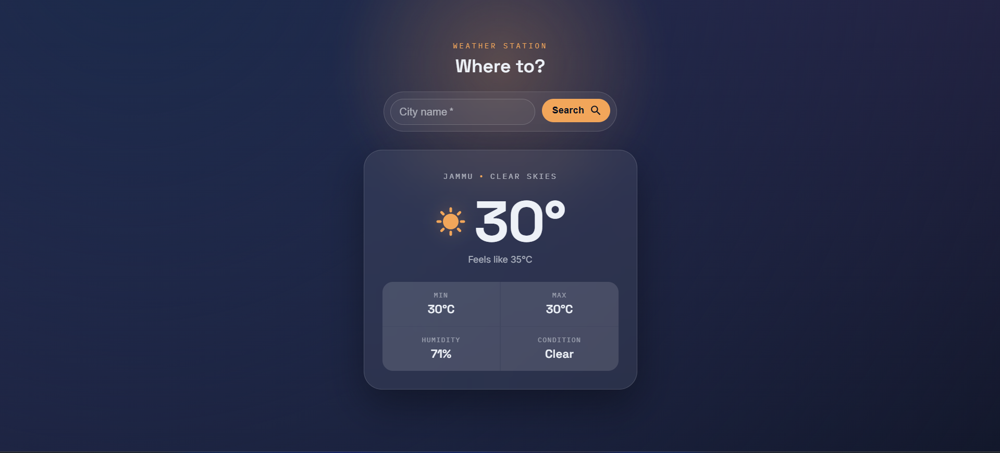

# 🌤️ Weather App

A React weather app that fetches live conditions from the OpenWeatherMap API and displays them in a glass-panel UI with a background that reacts to the actual weather — animated rain streaks, drifting snow, and a soft glow, depending on conditions.

[👉 View Live Demo](https://your-demo-link.com)


---

## Features

- 🔍 **Search any city** and get live temperature, humidity, min/max, and condition
- 🎨 **Weather-reactive theme** — background gradient, glow color, and icon all change based on current conditions (clear, cloudy, rain, thunderstorm, snow, mist)
- ✨ **Animated atmosphere** — subtle rain/snow/glow effects layered behind the UI, respecting `prefers-reduced-motion`
- 🧊 **Glassmorphism card** — frosted-glass instrument panel showing temperature, feels-like, and a stat grid
- ⚠️ **Error handling** — invalid city names show a friendly inline message instead of crashing

---

## Tech Stack

- **React** — component structure and state management
- **Vite** — dev server and build tooling
- **MUI (Material UI)** — form inputs, buttons, and icons
- **OpenWeatherMap API** — live weather data
- **Vanilla CSS** — CSS custom properties for theming, no CSS framework

---

## Getting Started

### 1. Clone and install

```bash
git clone <https://github.com/sohelkhan006/weather-station>
cd weather-app
npm install
```

### 2. Add your API key

Create a `.env` file in the project root:

```
VITE_WEATHER_API_KEY=your_openweathermap_api_key_here
```

Get a free key at [openweathermap.org/api](https://openweathermap.org/api). The `VITE_` prefix is required — Vite only exposes env vars to the client if they're prefixed this way.

### 3. Run the dev server

```bash
npm run dev
```

The app will be available at `http://localhost:5173` (or whichever port Vite prints).

### 4. Build for production

```bash
npm run build
```

---

## Project Structure

```
src/
├── WeatherApp.jsx        # Owns app state, renders the animated background + children
├── WeatherApp.css
├── SearchBox.jsx          # City search input, calls the API, handles loading/error
├── SearchBox.css
├── DisplayInfo.jsx        # Renders the weather card from props
├── DisplayInfo.css
├── weatherTheme.js        # Single source of truth: maps weather condition → colors + icon
└── index.css              # Global styles, font imports
```

## How It Works

1. `SearchBox` collects a city name and calls the OpenWeatherMap API.
2. The raw API response is reshaped into a clean object (`City`, `tempreture`, `feelLike`, `Tempmax`, `Tempmin`, `Humidity`, `Weather`) before it ever reaches app state.
3. `WeatherApp` holds that object in state and passes it down to `DisplayInfo` as props.
4. `weatherTheme.js` resolves the current condition to a theme (accent color, gradient, icon), which both the background (`WeatherApp`) and the card (`DisplayInfo`) read from — so they always stay visually in sync.

## Known Limitations / Future Improvements

- API key is exposed client-side (fine for a personal/demo project; a production version should proxy requests through a backend)
- No caching — repeat searches for the same city always hit the API again
- No persistence — last-searched city doesn't survive a page refresh
- Single-city view only — no saved list or comparison view yet


## Screenshots




## Authors

- [@sohelkhan006](https://www.github.com/sohelkhan006)

## License

MIT - Build under the MIT license